

# Landing Rectifying System for Flights

### Camera-guided glide-path correction in a Scratch landing simulator

**IE1004 Computational Thinking · Group 02 · July 2024**

An academic prototype that reads simulated **PAPI (Precision Approach Path Indicator)** lights with a webcam and sends corrective keyboard input to a Scratch aircraft game.

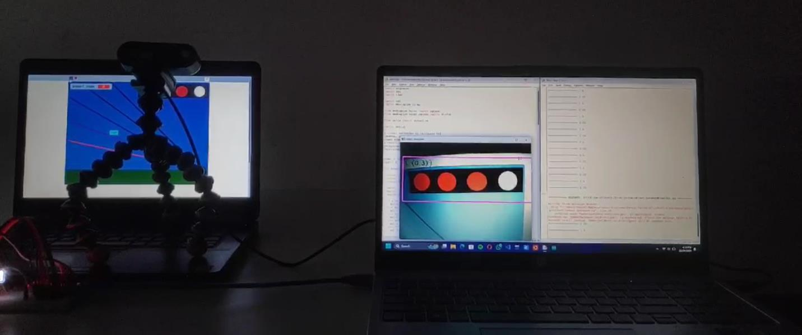

Actual project setup photographed for the group technical report, page 11.

> **Scope of demonstration.** The report documents a closed feedback loop in a custom *simulation*: a camera observes the game's PAPI display; a Python classifier selects one of five states; two Arduino boards relay that state and generate a keyboard command for the game. It does **not** document a flight-ready autoland system, a flight test, touchdown control, or quantified recognition accuracy.

## At a glance

| Layer | Documented implementation |
| --- | --- |
| Environment | Custom Scratch landing game with five approach bands |
| Visual feedback | Four-light PAPI indication rendered by the game |
| Sensing | External webcam viewing the game screen |
| Recognition | Python image-processing script and a model trained on 750 images, 150 per state, according to the report |
| Control link | Classifier output → Arduino Nano → five state lines → Arduino Pro Micro |
| Actuation | Pro Micro emulates keyboard input to adjust simulated aircraft altitude |
| Human display | Eight LEDs: a red/white pair for each of four PAPI positions |

## System architecture

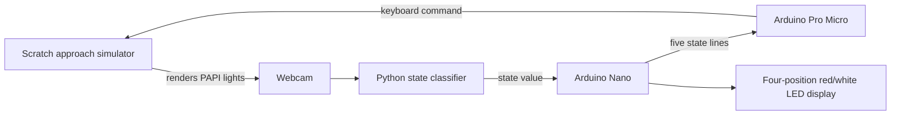

The camera observes **the simulator's visual output**, rather than airport lights outdoors. The feedback variable is a discrete approach-path category, and the corrective action changes the aircraft's vertical motion in the game. The report explicitly gives one example: detecting **too low** raises Nano analog pin 4, after which the Pro Micro sends `w` to increase simulated altitude. It does not provide the full state-to-key mapping, pin assignments for the other states, command timing, or source files.

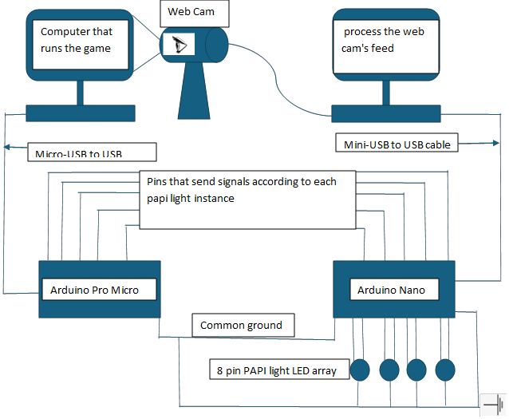

Report page 4: the team's original signal-flow and hardware diagram.

## PAPI state logic

PAPI is the correct term used in the report; “PEPI” in the informal project description refers to this system. The four lights encode the aircraft's vertical approach angle relative to the intended glide path.

| Simulated state | White | Red | Interpretation | Desired correction in this prototype |
| --- | ---: | ---: | --- | --- |
| Too high | 4 | 0 | Well above the path | Descend toward the path |
| Slightly high | 3 | 1 | Above the path | Reduce altitude relative to the path |
| On path | 2 | 2 | Near the target path | Maintain the approach |
| Slightly low | 1 | 3 | Below the path | Increase altitude relative to the path |
| Too low | 0 | 4 | Well below the path | Increase altitude; report explicitly documents `w` for this case |

These are **discrete guidance states**, not a continuous altitude measurement. The table describes intended control direction; the supplied report confirms the specific emitted key only for the *too low* example. Real PAPI interpretation is pilot guidance and does not, by itself, supply the full information required for an automatic landing.

  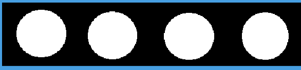
  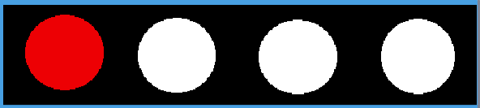
  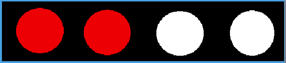
  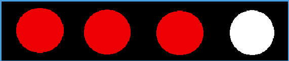
  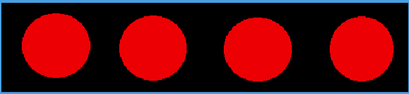

The five actual game light states reproduced from report pages 6–7.

## Built demonstrator

The team created the landing scene in Scratch. Five colored approach bands produce the corresponding PAPI indication as the aircraft moves through the scene. A webcam points at the display, while the Nano and Pro Micro connect the classifier output to both the LED array and the game controls.

  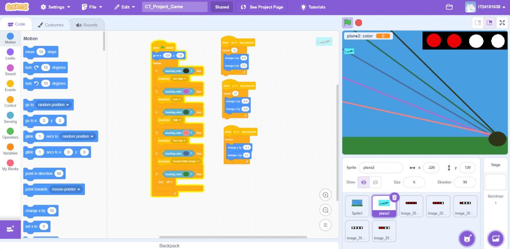
  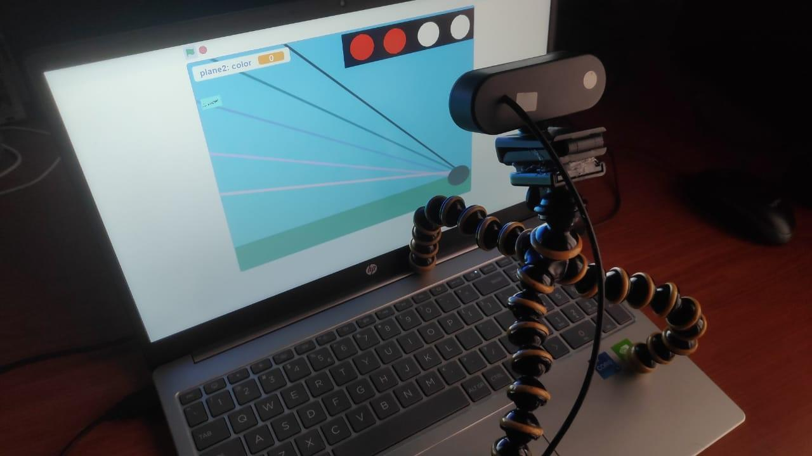

Scratch development view (page 7) and the actual camera installation (page 8).

  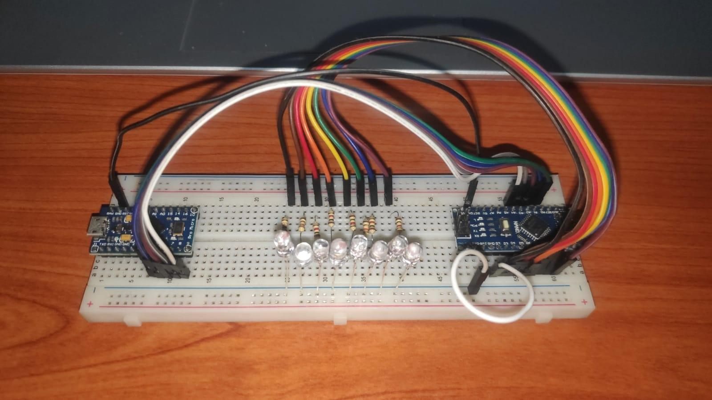
  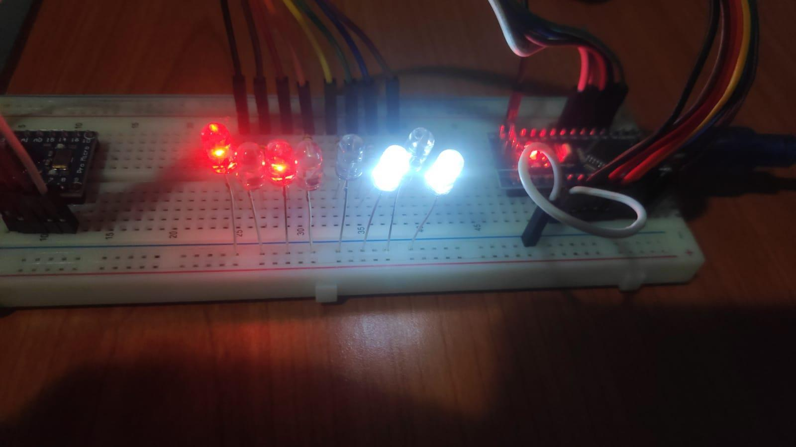

Assembled electronics (page 9) and one powered indication (page 10).

## Recognition and control details

The report states that five classes were represented by **150 images each**, for **750 training images**. It describes a Python script, Google Colab training, TensorFlow Lite use, and “linear regression” as the training algorithm. These terms are not reconciled in the report: without the model artifact or training notebook, the exact architecture, preprocessing, split, and inference procedure cannot be verified. No confusion matrix, test-set score, latency distribution, or low-light evaluation is supplied.

Two microcontrollers serve different interface roles. The Nano receives a state from Python and drives the LED display and five state lines. The Pro Micro reads those lines and acts as a USB keyboard for the Scratch host. The report says this division was chosen because the Nano in their setup did not emulate a keyboard. A shared electrical ground and reliable state transitions matter to reproducing the link; the report does not specify debounce, stale-state handling, or fault behavior.

The LED assembly uses **eight individual LEDs**: four red and four white. Each of the four PAPI positions has a red/white pair so the detected pattern can be recreated on the physical display. This is a cockpit-style indicator within the demonstrator, not an aircraft-certified display.

## Evidence and engineering status

| Claim | Evidence available here | Status |
| --- | --- | --- |
| Scratch landing scene and five PAPI patterns | Report figures, pages 5–7 | Documented visual design |
| Webcam aimed at game display | Photographs, page 8 | Documented physical setup |
| Nano/Pro Micro and LED breadboard | Photographs, pages 9–10 | Documented assembly |
| Complete two-computer demonstrator | Photograph, page 11 | Documented setup |
| 750-image, five-class training set | Report text, page 9 | Reported; dataset unavailable |
| Corrective key for “too low” | Report text, page 9 | Reported example; source unavailable |
| Recognition accuracy or safe landings | No measurement log or test protocol in report | Unverified |
| Real-aircraft landing capability | No aircraft integration or flight evidence | Outside demonstrated scope |

See [technical notes](docs/technical-notes.md) for the control interpretation, interface contract, failure cases, and a reproducible verification plan. A [public copy of the group report](docs/technical-report-group-02.pdf), with student IDs removed, is included as the primary source.

## Repository map

| Path | Purpose |
| --- | --- |
| [`docs/technical-report-group-02.pdf`](docs/technical-report-group-02.pdf) | July 2024 group report with student IDs removed |
| [`docs/technical-notes.md`](docs/technical-notes.md) | Detailed engineering reading and validation plan |
| [`assets/report/`](assets/report/) | Images extracted from the original report, named by PDF page |

The report does not include the Scratch project, Python inference script, training data/model, or Arduino sketches. They are therefore not represented here as runnable source. Adding those original files would make the prototype reproducible.

## Team and attribution

The report identifies **T. M. Ranmuthu, K. G. U. K. Iranthaka, K. P. D. H. Ariyasena, and D. R. M. De Silva** as Group 02 contributors. It does not assign individual implementation roles. All photographs and figures in this repository come from that group's report; filenames identify their PDF pages. The team credits a Python script sourced from the Freedomtech YouTube channel, but the report does not give a specific video URL or a software license.

